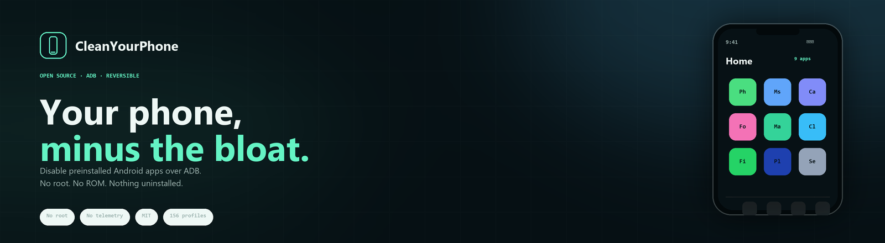
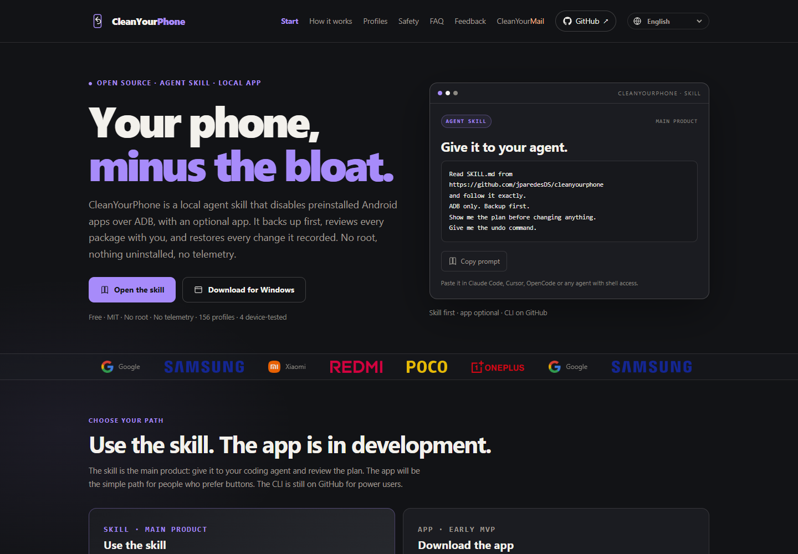

<p align="center">
  <a href="https://cleanyourphone.org/">
    
  </a>
</p>

<p align="center">
  <b>English</b> ·
  <a href="es.html">Español</a> ·
  <a href="pt-BR.html">Português (BR)</a> ·
  <a href="fr.html">Français</a> ·
  <a href="de.html">Deutsch</a> ·
  <a href="it.html">Italiano</a> ·
  <a href="ja.html">日本語</a> ·
  <a href="zh-CN.html">简体中文</a> ·
  <a href="zh-TW.html">繁體中文</a> ·
  <a href="ko.html">한국어</a>
</p>

<p align="center">
  <a href="https://github.com/jparedesDS/cleanyourphone">Skill</a> ·
  <a href="https://github.com/jparedesDS/cleanyourphone-app">Windows app</a> ·
  <a href="https://github.com/jparedesDS/cleanyourphone/blob/main/docs/FEEDBACK.md">Feedback docs</a>
</p>

<p align="center">
  <a href="https://cleanyourphone.org/"></a>
  
  
  
  <a href="https://github.com/jparedesDS/cleanyourphone-app/releases"></a>
</p>

# CleanYourPhone website

The **ten-language** landing page for [CleanYourPhone](https://github.com/jparedesDS/cleanyourphone),
the open-source, reversible Android debloat skill for coding agents. The site puts the **skill
first**, offers the optional **Windows app**, and lets anyone send a bug, improvement or phone
checklist without needing Discord.

Live: **<https://cleanyourphone.org/>**

Static HTML, CSS and JavaScript. No framework, no build step, no external fonts, no analytics and no
page-load third-party requests.

<p align="center">
  <a href="https://cleanyourphone.org/">
    
  </a>
</p>

## What is here

- **Skill-first hero:** a prompt card with **Open the skill** as the primary action and the Windows
  app as the secondary path.
- **Choose your path:** skill on the left as the main product, app on the right as an Early MVP, and
  the CLI as a small GitHub link.
- **How it works:** connect, review, apply or restore.
- **157 profiles:** official full-color logos for Google, Samsung, Xiaomi, Redmi, POCO and OnePlus.
- **Safety and FAQ:** the guardrails, undo limits, warranty and YouTube caveats.
- **Feedback:** a real form that posts to a Cloudflare Worker and then to the maintainer's Discord.
  No Discord account is needed to send.
- **Ten languages:** English, Spanish, Portuguese (BR), French, German, Italian, Japanese, Simplified
  Chinese, Traditional Chinese and Korean, with a native `<select>` in the nav.
- **Strict CSP, `security.txt`, canonical URLs, hreflang, Open Graph, JSON-LD, sitemap and a custom
  404.** The CSP allows only self-hosted assets plus the feedback Worker on submit.

## Languages

| Language | Page |
|---|---|
| English | <https://cleanyourphone.org/> |
| Español | <https://cleanyourphone.org/es.html> |
| Português (BR) | <https://cleanyourphone.org/pt-BR.html> |
| Français | <https://cleanyourphone.org/fr.html> |
| Deutsch | <https://cleanyourphone.org/de.html> |
| Italiano | <https://cleanyourphone.org/it.html> |
| 日本語 | <https://cleanyourphone.org/ja.html> |
| 简体中文 | <https://cleanyourphone.org/zh-CN.html> |
| 繁體中文 | <https://cleanyourphone.org/zh-TW.html> |
| 한국어 | <https://cleanyourphone.org/ko.html> |

Every page has the same canonical/hreflang set, its own Open Graph/JSON-LD locale, and the shared
feedback endpoint.

## Feedback Worker

```text
web form / app / skill  →  Cloudflare Worker  →  private Discord webhook
```

- Endpoint used by the page:
  `https://cleanyourphone-feedback.subtitleme.workers.dev`
- The webhook and `IP_SALT` live as Worker secrets; they are never in this repository or the app.
- The Worker accepts `feedback`, `bug` and `profile` messages with an optional checklist.
- It caps the body at 16 KB, rate-limits one request per hashed IP every five minutes, disables
  Discord mentions and does not store the message.
- Deployment, KV binding, CORS and secret steps:
  [feedback-worker/README.md](feedback-worker/README.md).

The web form sends only after the consent box is checked and **Send feedback** is pressed. The app
and skill use the same endpoint. `tools/phone.py` stays network-free; the skill uses
`scripts/feedback.py` as a separate opt-in helper.

## Preview locally

```bash
python -m http.server 8080
```

Open <http://localhost:8080/>. The feedback form needs the Worker endpoint and shows a send error if
it is unreachable.

## Files

| Path | What it is |
|---|---|
| `index.html` | English landing page. |
| `es.html` | Spanish landing page. |
| `pt-BR.html`, `fr.html`, `de.html`, `it.html` | Portuguese, French, German and Italian pages. |
| `ja.html`, `zh-CN.html`, `zh-TW.html`, `ko.html` | Japanese, Simplified Chinese, Traditional Chinese and Korean pages. |
| `styles.css` | Shared styles, language selector, feedback form and responsive layout. |
| `app.js` | Language picker, copy buttons, localized toast/feedback strings and the opt-in form. |
| `assets/logo.svg`, `assets/favicon.svg` | Primary mark and favicon. |
| `assets/banner.png` | Repository and page banner (1600×440). |
| `assets/og.png` | Social preview image (1280×640). |
| `assets/landing.png` | Live landing-page screenshot used by this README. |
| `assets/brands/` | Official brand PNGs and their source/trademark README. |
| `assets/brand/` | `banner-web`, `banner-skill`, `social-web`, `social-skill` variants. |
| `feedback-worker/` | Cloudflare Worker, deployment guide, tests and wrangler config. |
| `robots.txt`, `sitemap.xml` | Crawler metadata. |
| `.well-known/security.txt` | Security contact and policy. |
| `404.html` | Not-found page. |
| `tests/test_site.py` | Link, ID, language, CSP, metadata, feedback and asset checks. |

## Release sync

- `softwareVersion` in all ten landing pages must match `VERSION` in `tools/phone.py` in the
  skill repository. Current CLI: **`0.3.4`**.
- The app card links to `releases/latest` and states the current app version: **`v0.2.1`**.
- The feedback endpoint is duplicated in the two HTML files (`data-endpoint`) and in the app
  (`FEEDBACK_ENDPOINT`). Change all three together.
- When the JSON-LD block changes, recompute the CSP `sha256` hash in both pages and run the tests.

## Brand assets

The final logo, banner and social preview are checked in under `assets/`. The identity, palette,
logo usage and clear-space rules live in
[docs/BRAND.md](https://github.com/jparedesDS/cleanyourphone/blob/main/docs/BRAND.md).

The site uses lavender `#A78BFA` for actions and emphasis, white `#F3F1EC` for text, and graphite
`#121316` for the surface. CleanYourMail keeps its own orange `#FFB38A` wordmark.

The earlier phone-mockup banner generator has been retired; do not reintroduce it over the final
lockup assets.

## Deploy

This repository is a static site at the root and deploys with GitHub Pages.

1. **Settings → Pages**.
2. **Build and deployment → Source:** **Deploy from a branch**.
3. Branch: **`main`**, folder: **`/ (root)`**.
4. Save.

If the first build does not start, push any commit to `main`. The `pages build and deployment`
workflow should appear in **Actions**.

The feedback Worker is deployed separately from `feedback-worker/`; it is not part of the GitHub
Pages artifact.

## Tests

```bash
python -m pytest -q
```

Current site suite: **30 passed, 999 subtests**. It checks local links and assets, duplicate IDs,
the ten-language selector, page language, analytics absence, inline-style absence, the CSP hash
against JSON-LD, the feedback endpoint and CSP, third-party page-load requests, canonical/hreflang
metadata for every locale, PNG dimensions, the sitemap, `security.txt`, the skill-first order, the
prompt card and the inline icon system.

Worker tests:

```bash
cd feedback-worker
node --test worker.test.mjs
```

Current Worker suite: **7 passed** (validation, honeypot, CORS preflight, Discord payload, missing
webhook and rate limiting).

## Links

- **Skill repository:** <https://github.com/jparedesDS/cleanyourphone>
- **Windows app:** <https://github.com/jparedesDS/cleanyourphone-app>
- **App release:** <https://github.com/jparedesDS/cleanyourphone-app/releases/latest>
- **Connection guide:** <https://github.com/jparedesDS/cleanyourphone/blob/main/docs/CONNECT.md>
- **Feedback and privacy:** <https://github.com/jparedesDS/cleanyourphone/blob/main/docs/FEEDBACK.md>
- **Safety rules:** <https://github.com/jparedesDS/cleanyourphone/blob/main/docs/SAFETY.md>
- **Profiles:** <https://github.com/jparedesDS/cleanyourphone/tree/main/profiles>

## License

MIT. See [LICENSE](LICENSE). Brand names and logos are trademarks of their respective owners; see
`assets/brands/README.md`.
